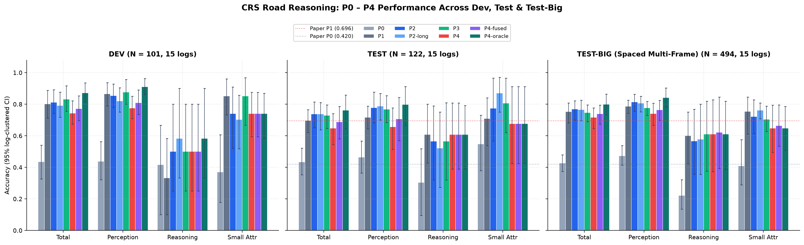
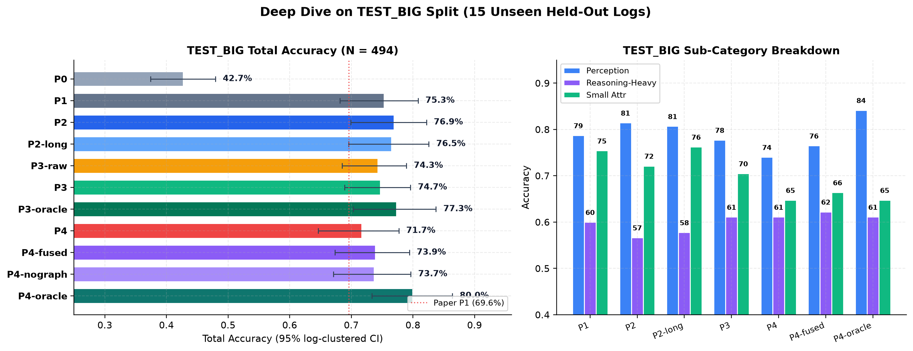
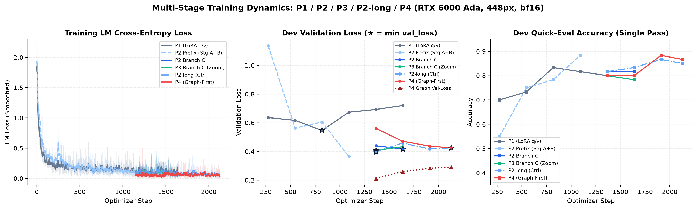
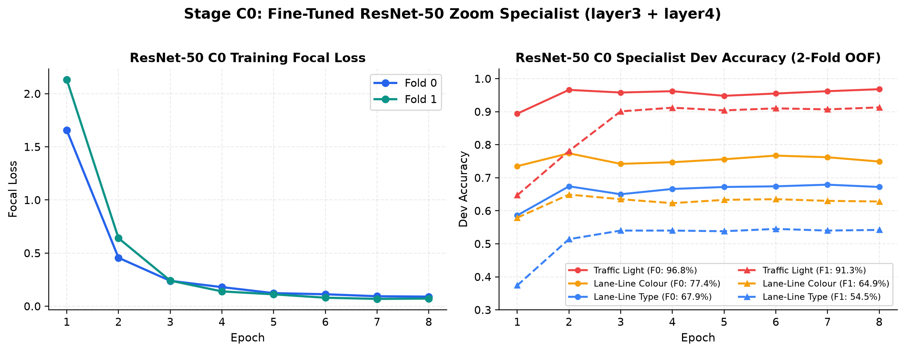
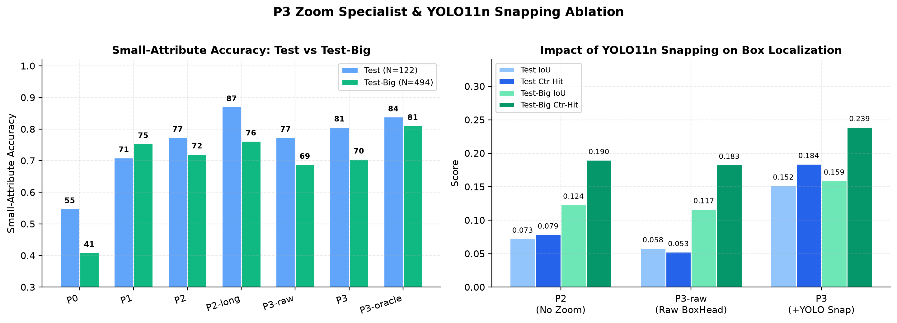
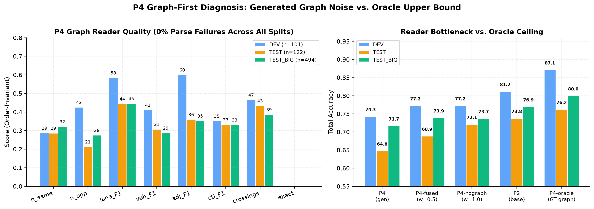
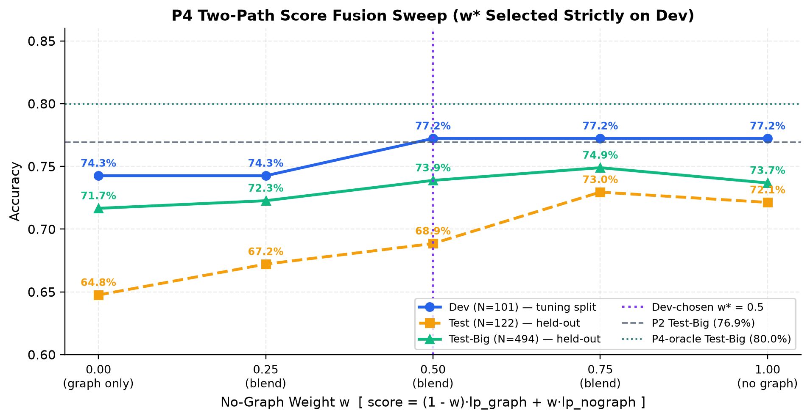
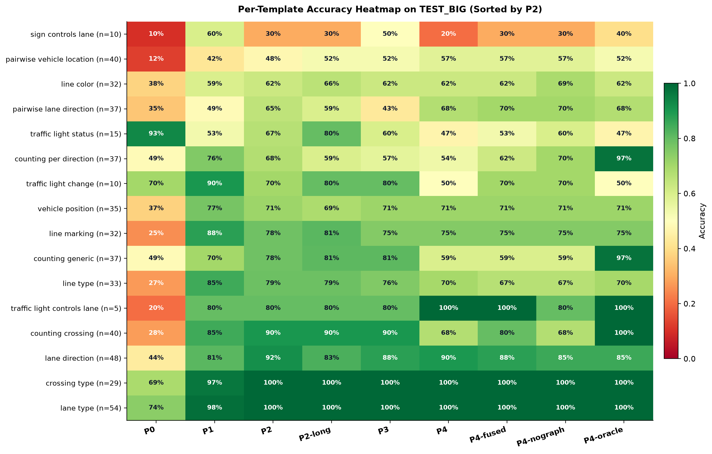
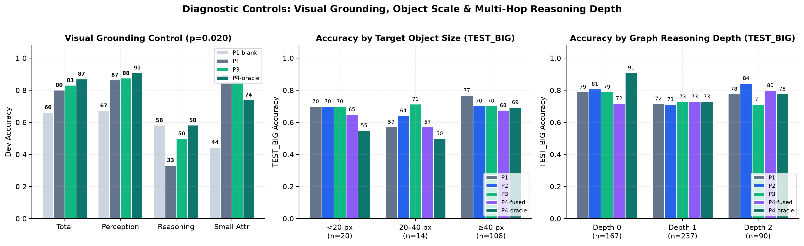
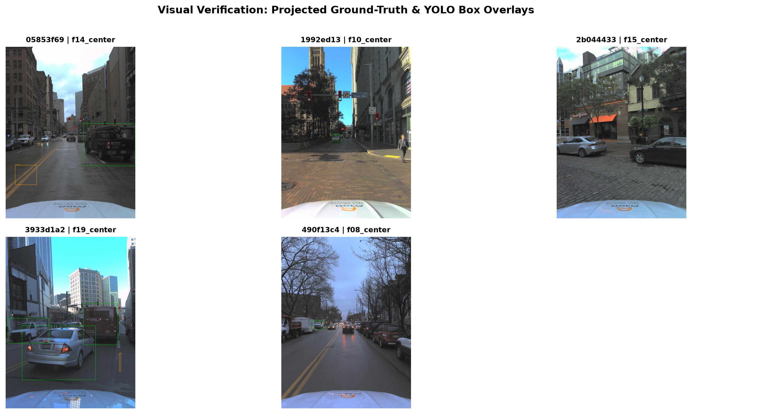

# CRS Road Reasoning — Complete Experimental Report (P0 – P4)

## 1. Executive Summary & Setup
- **Backbone & Training:** Qwen3-VL-2B-Instruct (`bf16`, `448px`, `LoRA r=16`, `batch=16`), 4-way option-permutation TTA across all evaluations.
- **Compute & Walltime:** Single NVIDIA RTX 6000 Ada (48 GB), probe speed `0.207 s/sample`, Job 10229 (P0–P3) + Job 10235 (P4 + P2-long + `test_big`), total `03:50:57`.
- **Dataset:** 80 real Argoverse 2 / OpenLane-V2 / MAPVQA logs (`50 train / 15 dev / 15 test` log-level split; `8731` train Qs; `101` dev Qs; `122` test Qs; `494` spaced multi-frame `test_big` Qs on the exact same 15 unseen test logs with `min_gap >= 4` frames and zero leakage).
- **Specialists:** ResNet-50 C0 (2-fold OOF): Fold 0: Light **96.8%**, Type **67.9%**, Colour **77.4%**; Fold 1: Light **91.3%**, Type **54.5%**, Colour **64.9%**. YOLO11n traffic-light recall@0.3: `55.7%` (original scenes) / `59.9%` (137 new `test_big` scenes).

### Headline Takeaways (TEST_BIG, N = 494)
1. **Strongest Deployable Model — P2 (76.9%):** Outperforms P1 (75.3%), P3 (74.7%), and P4-fused (73.9%) on `test_big`. Compute-matched `P2-long` confirms extra Stage C training alone does not push past P2.
2. **Graph Conditioning Ceiling Confirmed — P4-oracle (80.0%):** Feeding accurate scene graphs beats every model across every split (`+3.1 pp` over P2, `+8.3 pp` over P4 on `test_big`, $p = 5.3 	imes 10^{-8}$), proving the answerer effectively leverages explicit graph structure.
3. **Reader Bottleneck Diagnosed:** P4 achieved **0% parse failures** across all generated graphs, but 2B-scale graph prediction on unseen frames remains noisy (`lane_F1 = 0.446`, `veh_F1 = 0.288`, `exact = 0.0` on `test_big`). Two-path dev-tuned fusion (`w* = 0.5`) recovers accuracy (`P4 71.7% → P4-fused 73.9%`) and reaches the **highest Reasoning-Heavy accuracy (62.2% vs P2 56.7%)**.
4. **P3 Zoom & YOLO Snapping:** YOLO snapping lifts traffic-light localization (`IoU 0.058 → 0.152` on test; `0.159` on `test_big`), giving strong Small-Attr gains on `test` (`80.6%`, `83.9%` oracle), though noisy un-snapped lane-line hints dilute overall `test_big` accuracy at `448px`.
5. **Verified Visual Grounding:** Removing images (`P1-blank`) drops Dev accuracy from `80.2%` to `66.3%` (McNemar $p = 0.020$) and Small Attr by `>40 pp`.

---

## 2. Quantitative Results Across All Splits

### DEV Split (N = 101, 15 Held-Out Logs)
| Model | N | Total (95% CI) | Perception | Reasoning | Small Attr | IoU | Ctr-Hit | Hints | Snap |
| :--- | :---: | :---: | :---: | :---: | :---: | :---: | :---: | :---: | :---: |
| **P1-blank** *(no img)* | 101 | 66.3% [59.5, 73.5] | 67.4% | 58.3% | 44.4% | — | — | 0 | 0 |
| **P0** | 101 | 43.6% [32.7, 54.0] | 43.8% | 41.7% | 37.0% | — | — | 0 | 0 |
| **P1** | 101 | 80.2% [71.3, 88.8] | 86.5% | 33.3% | 85.2% | — | — | 0 | 0 |
| **P2** | 101 | 81.2% [74.2, 89.2] | 85.4% | 50.0% | 74.1% | 0.018 | 0.000 | 0 | 0 |
| **P2-long** | 101 | 79.2% [71.8, 87.6] | 82.0% | 58.3% | 70.4% | 0.025 | 0.000 | 0 | 0 |
| **P3-raw** | 101 | 83.2% [75.5, 91.7] | 87.6% | 50.0% | 85.2% | 0.015 | 0.000 | 27 | 0 |
| **P3** | 101 | 83.2% [75.5, 91.7] | 87.6% | 50.0% | 85.2% | 0.164 | 0.214 | 27 | 8 |
| **P3-oracle** | 101 | 83.2% [75.5, 91.7] | 87.6% | 50.0% | 85.2% | 1.000* | 1.000* | 27 | 0 |
| **P4** | 101 | 74.3% [67.5, 82.1] | 77.5% | 50.0% | 74.1% | 0.018 | 0.000 | 0 | 0 |
| **P4-fused** | 101 | 77.2% [69.6, 85.3] | 80.9% | 50.0% | 74.1% | 0.018 | 0.000 | 0 | 0 |
| **P4-nograph** | 101 | 77.2% [68.2, 85.8] | 80.9% | 50.0% | 74.1% | 0.018 | 0.000 | 0 | 0 |
| **P4-oracle** | 101 | 87.1% [81.4, 93.5] | 91.0% | 58.3% | 74.1% | 0.018 | 0.000 | 0 | 0 |

### TEST Split (N = 122, 15 Held-Out Logs)
| Model | N | Total (95% CI) | Perception | Reasoning | Small Attr | IoU | Ctr-Hit | Hints | Snap |
| :--- | :---: | :---: | :---: | :---: | :---: | :---: | :---: | :---: | :---: |
| **P0** | 122 | 43.4% [35.4, 52.2] | 46.5% | 30.4% | 54.8% | — | — | 0 | 0 |
| **P1** | 122 | 69.7% [62.2, 76.6] | 71.7% | 60.9% | 71.0% | — | — | 0 | 0 |
| **P2** | 122 | 73.8% [65.2, 81.4] | 77.8% | 56.5% | 77.4% | 0.073 | 0.079 | 0 | 0 |
| **P2-long** | 122 | 73.8% [63.8, 81.1] | 78.8% | 52.2% | 87.1% | 0.061 | 0.053 | 0 | 0 |
| **P3-raw** | 122 | 72.1% [62.6, 79.1] | 75.8% | 56.5% | 77.4% | 0.058 | 0.053 | 31 | 0 |
| **P3** | 122 | 73.0% [64.6, 79.6] | 76.8% | 56.5% | 80.6% | 0.152 | 0.184 | 31 | 9 |
| **P3-oracle** | 122 | 73.8% [64.7, 80.6] | 77.8% | 56.5% | 83.9% | 1.000* | 1.000* | 31 | 0 |
| **P4** | 122 | 64.8% [54.5, 74.0] | 65.7% | 60.9% | 67.7% | 0.086 | 0.132 | 0 | 0 |
| **P4-fused** | 122 | 68.9% [58.0, 78.6] | 70.7% | 60.9% | 67.7% | 0.086 | 0.132 | 0 | 0 |
| **P4-nograph** | 122 | 72.1% [62.0, 81.4] | 74.7% | 60.9% | 71.0% | 0.086 | 0.132 | 0 | 0 |
| **P4-oracle** | 122 | 76.2% [64.4, 85.8] | 79.8% | 60.9% | 67.7% | 0.086 | 0.132 | 0 | 0 |

### TEST_BIG Split (N = 494, 15 Held-Out Logs)
| Model | N | Total (95% CI) | Perception | Reasoning | Small Attr | IoU | Ctr-Hit | Hints | Snap |
| :--- | :---: | :---: | :---: | :---: | :---: | :---: | :---: | :---: | :---: |
| **P0** | 494 | 42.7% [37.4, 48.0] | 47.3% | 22.2% | 41.0% | — | — | 0 | 0 |
| **P1** | 494 | 75.3% [68.2, 80.8] | 78.7% | 60.0% | 75.4% | — | — | 0 | 0 |
| **P2** | 494 | 76.9% [69.9, 82.2] | 81.4% | 56.7% | 72.1% | 0.124 | 0.190 | 0 | 0 |
| **P2-long** | 494 | 76.5% [69.5, 82.6] | 80.7% | 57.8% | 76.2% | 0.079 | 0.148 | 0 | 0 |
| **P3-raw** | 494 | 74.3% [68.5, 78.9] | 77.2% | 61.1% | 68.9% | 0.117 | 0.183 | 122 | 0 |
| **P3** | 494 | 74.7% [68.9, 79.6] | 77.7% | 61.1% | 70.5% | 0.159 | 0.239 | 122 | 19 |
| **P3-oracle** | 494 | 77.3% [70.3, 83.7] | 80.9% | 61.1% | 81.1% | 1.000* | 1.000* | 112 | 0 |
| **P4** | 494 | 71.7% [64.6, 77.7] | 74.0% | 61.1% | 64.8% | 0.119 | 0.211 | 0 | 0 |
| **P4-fused** | 494 | 73.9% [67.4, 79.4] | 76.5% | 62.2% | 66.4% | 0.119 | 0.211 | 0 | 0 |
| **P4-nograph** | 494 | 73.7% [67.1, 79.6] | 76.5% | 61.1% | 68.9% | 0.119 | 0.211 | 0 | 0 |
| **P4-oracle** | 494 | 80.0% [73.3, 86.4] | 84.2% | 61.1% | 64.8% | 0.119 | 0.211 | 0 | 0 |

*Note: `P3-oracle` feeds ground-truth bounding boxes to ResNet-50 (`IoU = 1.000` by definition). CIs are 95% log-clustered bootstrap intervals.*

## 3. Paired Statistical Significance (Two-Sided Exact McNemar)
| Split | Comparison (A vs B) | N | Acc A | Acc B | Δ (A−B) | A-only / B-only | McNemar p |
| :--- | :--- | :---: | :---: | :---: | :---: | :---: | :---: |
| DEV | P2 vs P1 | 101 | 81.2% | 80.2% | +1.0 pp | 9 / 8 | 1.0000 |
| DEV | P3 vs P1 | 101 | 83.2% | 80.2% | +3.0 pp | 9 / 6 | 0.6072 |
| DEV | P3 vs P2 | 101 | 83.2% | 81.2% | +2.0 pp | 4 / 2 | 0.6875 |
| DEV | P2-long vs P2 | 101 | 79.2% | 81.2% | -2.0 pp | 3 / 5 | 0.7266 |
| DEV | P4 vs P2 | 101 | 74.3% | 81.2% | -6.9 pp | 5 / 12 | 0.1435 |
| DEV | P4 vs P2-long | 101 | 74.3% | 79.2% | -5.0 pp | 5 / 10 | 0.3018 |
| DEV | P4-fused vs P2 | 101 | 77.2% | 81.2% | -4.0 pp | 5 / 9 | 0.4240 |
| DEV | P4-fused vs P2-long | 101 | 77.2% | 79.2% | -2.0 pp | 6 / 8 | 0.7905 |
| DEV | P4 vs P4-nograph | 101 | 74.3% | 77.2% | -3.0 pp | 4 / 7 | 0.5488 |
| DEV | P4-oracle vs P4 | 101 | 87.1% | 74.3% | +12.9 pp | 14 / 1 |  **9.77e-04** |
| DEV | P4-oracle vs P2 | 101 | 87.1% | 81.2% | +5.9 pp | 8 / 2 | 0.1094 |
| TEST | P2 vs P1 | 122 | 73.8% | 69.7% | +4.1 pp | 15 / 10 | 0.4244 |
| TEST | P3 vs P1 | 122 | 73.0% | 69.7% | +3.3 pp | 17 / 13 | 0.5847 |
| TEST | P3 vs P2 | 122 | 73.0% | 73.8% | -0.8 pp | 5 / 6 | 1.0000 |
| TEST | P2-long vs P2 | 122 | 73.8% | 73.8% | +0.0 pp | 6 / 6 | 1.0000 |
| TEST | P4 vs P2 | 122 | 64.8% | 73.8% | -9.0 pp | 5 / 16 |  **0.0266** |
| TEST | P4 vs P2-long | 122 | 64.8% | 73.8% | -9.0 pp | 4 / 15 |  **0.0192** |
| TEST | P4-fused vs P2 | 122 | 68.9% | 73.8% | -4.9 pp | 5 / 11 | 0.2101 |
| TEST | P4-fused vs P2-long | 122 | 68.9% | 73.8% | -4.9 pp | 7 / 13 | 0.2632 |
| TEST | P4 vs P4-nograph | 122 | 64.8% | 72.1% | -7.4 pp | 3 / 12 |  **0.0352** |
| TEST | P4-oracle vs P4 | 122 | 76.2% | 64.8% | +11.5 pp | 16 / 2 |  **0.0013** |
| TEST | P4-oracle vs P2 | 122 | 76.2% | 73.8% | +2.5 pp | 9 / 6 | 0.6072 |
| TEST_BIG | P2 vs P1 | 494 | 76.9% | 75.3% | +1.6 pp | 52 / 44 | 0.4752 |
| TEST_BIG | P3 vs P1 | 494 | 74.7% | 75.3% | -0.6 pp | 50 / 53 | 0.8439 |
| TEST_BIG | P3 vs P2 | 494 | 74.7% | 76.9% | -2.2 pp | 23 / 34 | 0.1849 |
| TEST_BIG | P2-long vs P2 | 494 | 76.5% | 76.9% | -0.4 pp | 27 / 29 | 0.8939 |
| TEST_BIG | P4 vs P2 | 494 | 71.7% | 76.9% | -5.3 pp | 17 / 43 |  **0.0011** |
| TEST_BIG | P4 vs P2-long | 494 | 71.7% | 76.5% | -4.9 pp | 34 / 58 |  **0.0160** |
| TEST_BIG | P4-fused vs P2 | 494 | 73.9% | 76.9% | -3.0 pp | 17 / 32 |  **0.0444** |
| TEST_BIG | P4-fused vs P2-long | 494 | 73.9% | 76.5% | -2.6 pp | 32 / 45 | 0.1711 |
| TEST_BIG | P4 vs P4-nograph | 494 | 71.7% | 73.7% | -2.0 pp | 20 / 30 | 0.2026 |
| TEST_BIG | P4-oracle vs P4 | 494 | 80.0% | 71.7% | +8.3 pp | 50 / 9 |  **5.26e-08** |
| TEST_BIG | P4-oracle vs P2 | 494 | 80.0% | 76.9% | +3.0 pp | 38 / 23 | 0.0722 |
| DEV | P1 vs P1-blank | 101 | 80.2% | 66.3% | +13.9 pp | 23 / 9 | **0.0201** |

## 4. P4 Graph Reader Quality (Order-Invariant Metrics)
| Split | N Graphs | Parse Fail | n_same | n_opp | lane_F1 | veh_F1 | adj_F1 | ctl_F1 | Crossings | Exact |
| :--- | :---: | :---: | :---: | :---: | :---: | :---: | :---: | :---: | :---: | :---: |
| **DEV** | 101 | 0 | 0.287 | 0.426 | 0.585 | 0.411 | 0.600 | 0.352 | 0.465 | 0.000 |
| **TEST** | 122 | 0 | 0.287 | 0.213 | 0.444 | 0.307 | 0.360 | 0.332 | 0.434 | 0.000 |
| **TEST_BIG** | 494 | 0 | 0.322 | 0.275 | 0.446 | 0.288 | 0.352 | 0.331 | 0.387 | 0.000 |

## 5. P4 Two-Path Score Fusion Sweep (Dev-Tuned)
| No-Graph Weight `w` | DEV | TEST | TEST_BIG |
| :---: | :---: | :---: | :---: |
| `0.00` | 74.3% | 64.8% | 71.7% |
| `0.25` | 74.3% | 67.2% | 72.3% |
| `0.50` **(w\*)** | 77.2% | 68.9% | 73.9% |
| `0.75` | 77.2% | 73.0% | 74.9% |
| `1.00` | 77.2% | 72.1% | 73.7% |

## 6. Per-Template Accuracy Breakdown (TEST_BIG)
| Template | N | P0 | P1 | P2 | P2-long | P3 | P4 | P4-fused | P4-oracle |
| :--- | :---: | :---: | :---: | :---: | :---: | :---: | :---: | :---: | :---: |
| `counting_crossing` | 40 | 27.5% | 85.0% | 90.0% | 90.0% | 90.0% | 67.5% | 80.0% | **100%** |
| `counting_generic` | 37 | 48.6% | 70.3% | 78.4% | 81.1% | 81.1% | 59.5% | 59.5% | **97%** |
| `counting_per_direction` | 37 | 48.6% | 75.7% | 67.6% | 59.5% | 56.8% | 54.1% | 62.2% | **97%** |
| `crossing_type` | 29 | 69.0% | 96.6% | **100%** | **100%** | **100%** | **100%** | **100%** | **100%** |
| `lane_direction` | 48 | 43.8% | 81.2% | **92%** | 83.3% | 87.5% | 89.6% | 87.5% | 85.4% |
| `lane_type` | 54 | 74.1% | 98.1% | **100%** | **100%** | **100%** | **100%** | **100%** | **100%** |
| `line_color` | 32 | 37.5% | 59.4% | 62.5% | **66%** | 62.5% | 62.5% | 62.5% | 62.5% |
| `line_marking` | 32 | 25.0% | **88%** | 78.1% | 81.2% | 75.0% | 75.0% | 75.0% | 75.0% |
| `line_type` | 33 | 27.3% | **85%** | 78.8% | 78.8% | 75.8% | 69.7% | 66.7% | 69.7% |
| `pairwise_lane_direction` | 37 | 35.1% | 48.6% | 64.9% | 59.5% | 43.2% | 67.6% | **70%** | 67.6% |
| `pairwise_vehicle_location` | 40 | 12.5% | 42.5% | 47.5% | 52.5% | 52.5% | **57%** | **57%** | 52.5% |
| `sign_controls_lane` | 10 | 10.0% | **60%** | 30.0% | 30.0% | 50.0% | 20.0% | 30.0% | 40.0% |
| `traffic_light_change` | 10 | 70.0% | **90%** | 70.0% | 80.0% | 80.0% | 50.0% | 70.0% | 50.0% |
| `traffic_light_controls_lane` | 5 | 20.0% | 80.0% | 80.0% | 80.0% | 80.0% | **100%** | **100%** | **100%** |
| `traffic_light_status` | 15 | **93%** | 53.3% | 66.7% | 80.0% | 60.0% | 46.7% | 53.3% | 46.7% |
| `vehicle_position` | 35 | 37.1% | **77%** | 71.4% | 68.6% | 71.4% | 71.4% | 71.4% | 71.4% |

## 7. Qualitative P4 Graph Reader Inspection (TEST_BIG)

### Reader Error (P4 Wrong, P4-oracle Right) (`big_0a524e66-ee33-3b6c-89ef-eac1985316db__f20_17`, template: `sign_controls_lane`)
- **Question:** —
- **Generated Graph (P4, lane_F1=0.67):**
```text
L1: opposite | standard vehicle lane | left of L4
L2: opposite | standard vehicle lane | left of L5
L3: opposite | standard vehicle lane | left of L6
L4: same | standard vehicle lane
L5: same | standard vehicle lane
L6: same | standard vehicle lane
L7: same | standard vehicle lane
Unassigned: bus1
Controls: sign1>L5; sign2>L6; sign3>L6
Crossings: 4
Totals: 4 same, 3 opposite
```
- **Ground-Truth Graph (P4-oracle):**
```text
L1: opposite | standard vehicle lane | left of L9
L2: opposite | standard vehicle lane | left of L11
L3: opposite | standard vehicle lane | left of L4
L4: opposite | standard vehicle lane | left of L8
L5: opposite | standard vehicle lane | left of L6
L6: opposite | standard vehicle lane | left of L7
L7: opposite | standard vehicle lane | left of L14
L8: same | standard vehicle lane | left of L12
L9: same | standard vehicle lane | left of L10
L10: same | standard vehicle lane
L11: same | standard vehicle lane
L12: same | standard vehicle lane | left of L13 | has ego
L13: same | standard vehicle lane
L14: same | standard vehicle lane
Controls: sign1>L8; light1>L8,L12,L13; light2>L8,L12,L13
Crossings: 1
Totals: 7 same, 7 opposite
```

### Reader Success (Both P4 & P4-oracle Right) (`big_3b2994cb-5f82-4835-9212-0cac8fb3d164__f17_21`, template: `lane_direction`)
- **Question:** —
- **Generated Graph (P4, lane_F1=0.62):**
```text
L1: opposite | bike lane | left of L2
L2: opposite | standard vehicle lane | left of L4
L3: opposite | standard vehicle lane | left of L5
L4: same | standard vehicle lane | left of L6 | has ego
L5: same | bike lane
L6: same | standard vehicle lane
Crossings: 0
Totals: 3 same, 3 opposite
```
- **Ground-Truth Graph (P4-oracle):**
```text
L1: opposite | standard vehicle lane | left of L6
L2: opposite | standard vehicle lane
L3: opposite | bike lane | left of L4, L5
L4: opposite | standard vehicle lane
L5: opposite | standard vehicle lane | left of L6
L6: same | standard vehicle lane | left of L7 | has ego, vehicle1
L7: same | bike lane
Unassigned: large-vehicle1
Crossings: 0
Totals: 2 same, 5 opposite
```

## 8. Figures

### Figure 1: Overall & Sub-Category Accuracy Across Dev, Test, and Test-Big (95% Log-Clustered CIs)


### Figure 2: Deep Dive on TEST_BIG Split — Ranked Total Accuracy & Sub-Category Breakdown


### Figure 3: Multi-Stage Training Loss, Dev Validation Loss (including P4 Graph Loss), and Dev Quick-Eval Accuracy


### Figure 4: ResNet-50 C0 2-Fold Specialist Training Focal Loss & Dev Accuracy


### Figure 5: P3 Small-Attribute Accuracy & YOLO11n Box Localization Ablation


### Figure 6: P4 Order-Invariant Graph Reader Quality vs. Oracle Upper Bound


### Figure 7: P4 Two-Path Score Fusion Sweep (Dev-Chosen w* Applied to Test & Test-Big)


### Figure 8: Per-Template Accuracy Heatmap on TEST_BIG Across All Models


### Figure 9: Diagnostic Controls — Visual Grounding (P1-blank), Target Object Size & Graph Reasoning Depth


### Figure 10: Projected Ground-Truth & YOLO Box Overlays

